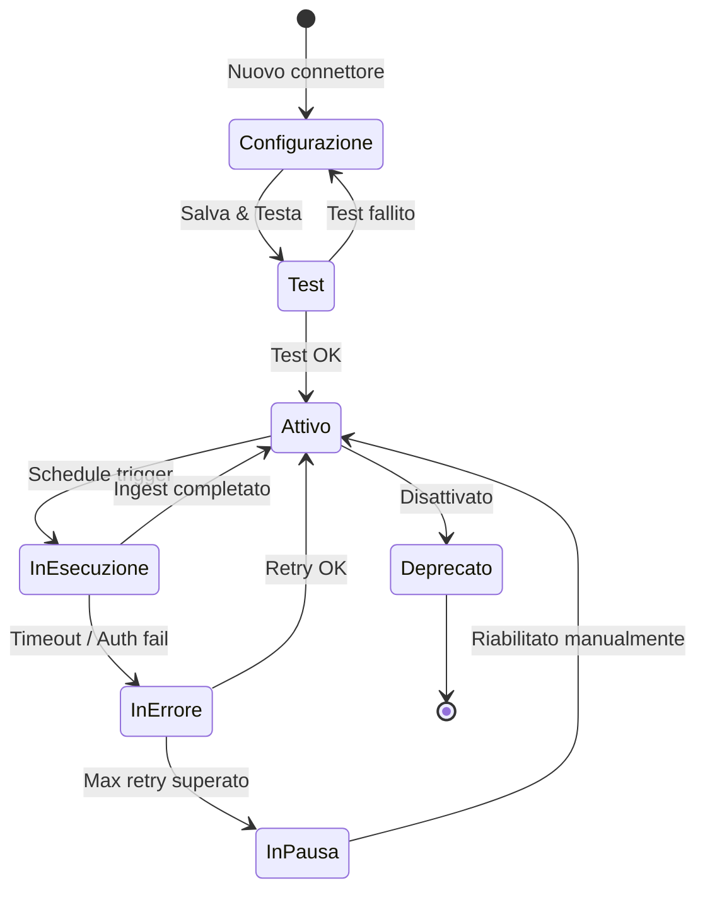
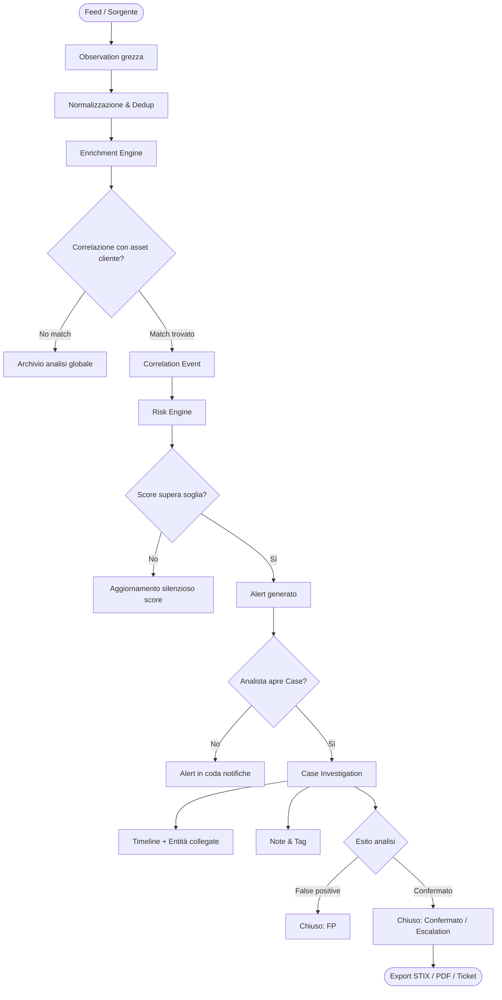
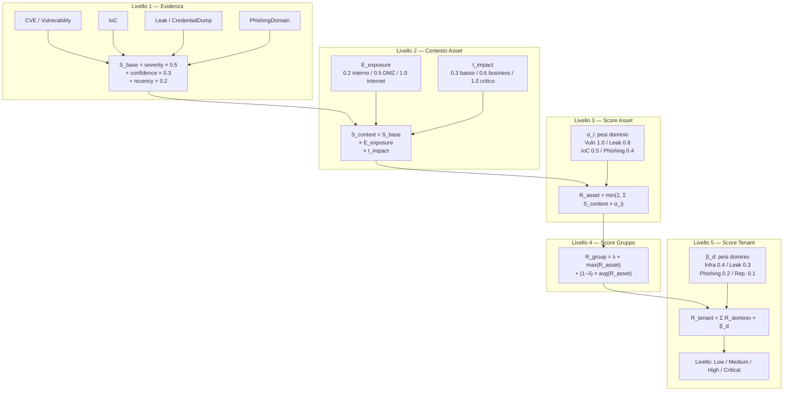
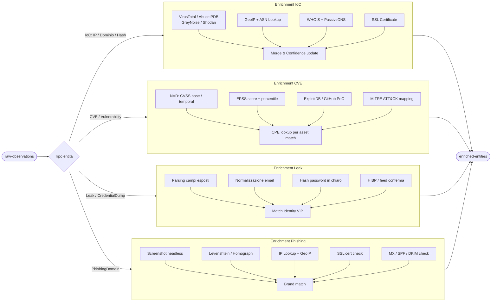
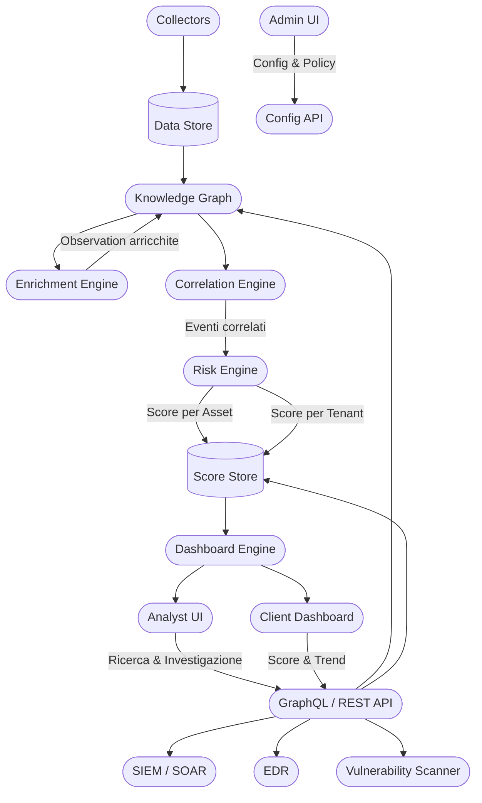
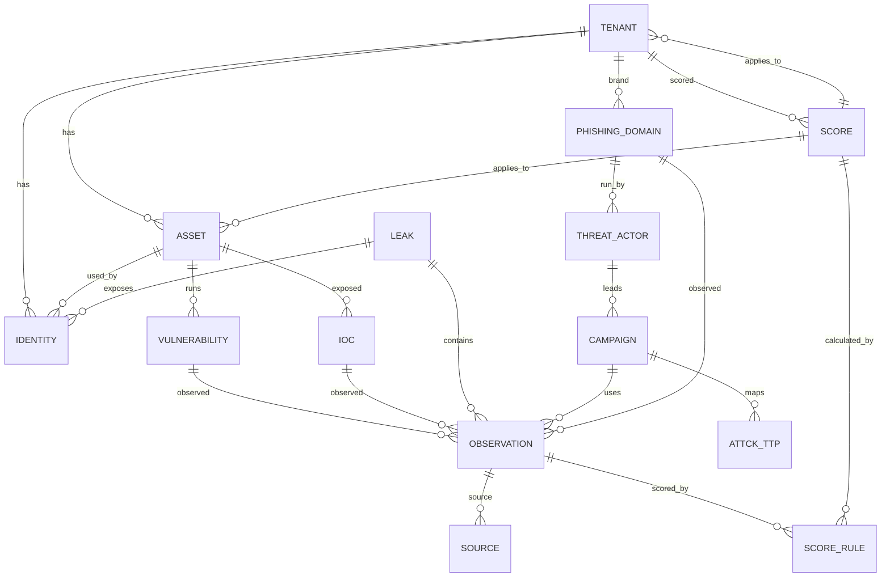
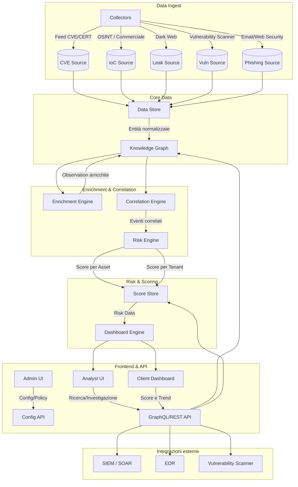
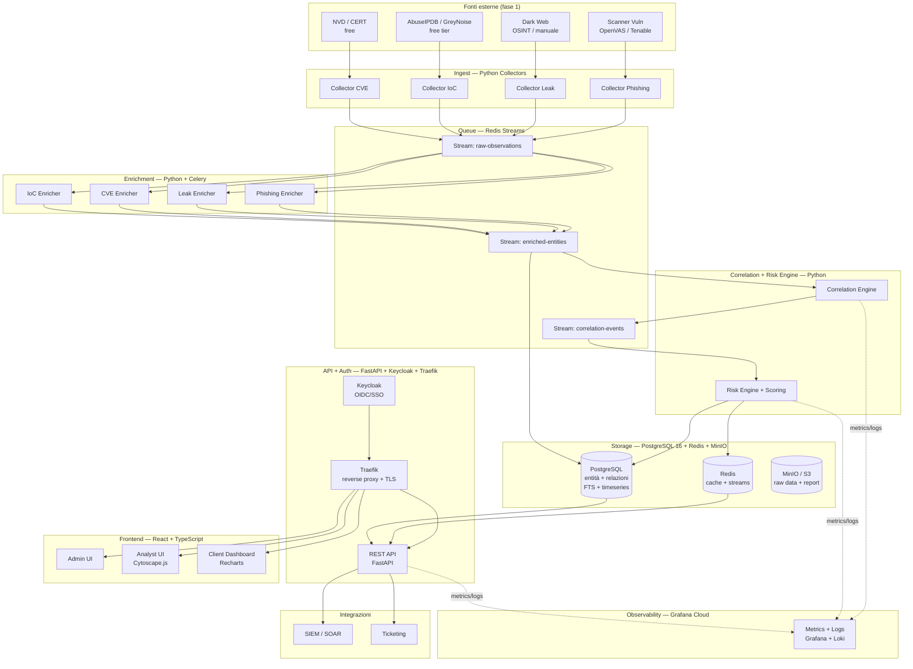
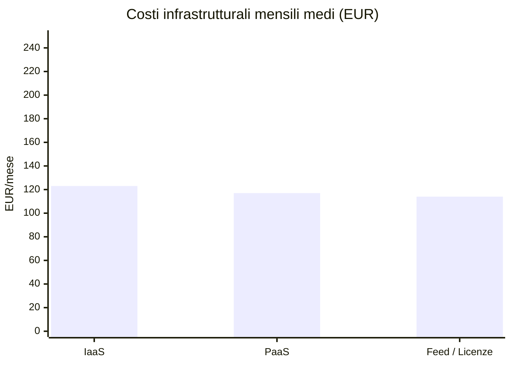

# Sentinel AI

**Data:** 26 maggio 2026 · **Aggiornato:** 9 novembre 2026

**Versione:** 0.2

> **Come leggere questo documento dopo il rebuild (09/11/2026).** Questo è il disegno di riferimento della piattaforma: visione, aree funzionali, modello dati, formule di scoring ufficiali, stack e costi. È stato scritto per il vecchio codice e resta valido come obiettivo. Il codice del rebuild (ottobre 2026) ne implementa una parte e in alcuni punti se ne discosta; le differenze sono segnalate nelle sezioni 4.3, 5 e 9 e descritte per intero in `docs/STATO-PROGETTO.md`. Le sezioni 3, 6, 7, 8 e 10 non sono state toccate: descrivono il prodotto obiettivo, non lo stato del codice.

---

## 1. Scopo del documento

Questo documento descrive:

- Gli obiettivi, lo scope e la visione della piattaforma di threat intelligence.
- Il modello di scoring formale (asset, gruppo, cliente).
- La struttura dati (entità e relazioni).
- L'architettura logica dei sistemi.

Il documento è pensato per essere:

- Base per product requirements.
- Riferimento per architetti e team di sviluppo.
- Supporto per la stesura di wireframe e sprint planning.

---

## 2. Obiettivi e scope

### 2.1 Obiettivi principali

- Aggregare, normalizzare e correlare fonti eterogenee di threat intelligence:
    - IoC (IP, hostname, dominio, hash, URL, email).
    - Vulnerabilità (CVE, CVSS, EPSS, prodotto, versione).
    - Threat actor e campagne (con mapping ATT&CK).
    - Leak, credential dump, fughe di dati e dati sul dark web.
    - Segnali di phishing e typosquatting (domini, certificati, brand).
- Associare queste evidenze agli **asset** dei clienti e calcolare un **risk score** interpretabile e tracciabile.
- Fornire tre zone funzionali distinte:
    - **Analisi**: per analisti e SOC.
    - **Clienti**: dashboard e report per il cliente.
    - **Amministrazione**: gestione utenti, connettori, policy, tenant.

### 2.2 Scope e limiti

- La piattaforma **non è** un SIEM, SOAR o EDR, ma un **layer di intelligence** a integrazione con questi sistemi.
- Non fornisce gestione diretta degli host (patching, hardening), ma può:
    - Produrre alert e raccomandazioni.
    - Integrarsi con workflow esterni.
- Non implementa la raccolta dati dai firewall/EDR, ma può consumarne i dati tramite API.

---

## 3. Aree funzionali

### 3.1 Amministrazione

Area riservata a super-admin e operatori interni.

#### Gestione connettori / collectors

Ogni connettore è descritto da una scheda di configurazione con i seguenti campi:

- **ID connettore**: identificatore univoco.
- **Tipo sorgente**: ufficiale (NVD, CERT), commerciale (es. Recorded Future, Shodan), OSINT (GreyNoise, AbuseIPDB), dark web, manuale, interno.
- **Protocollo di ingest**: pull via API REST, pull via feed STIX/TAXII, push via webhook, upload manuale CSV/JSON.
- **Periodicità**: cron expression configurabile (es. ogni 15 min, ogni ora, ogni 24h).
- **Rate limit**: max request/minuto e backoff strategy (lineare, esponenziale).
- **Retry policy**: max tentativi, timeout per richiesta.
- **Schema di mapping**: trasformazione dal formato nativo al modello interno (campo sorgente → campo entità).
- **Policy di validazione**: campi obbligatori, formati attesi (es. IPv4/IPv6, FQDN, SHA256), soglia minima di confidence.
- **Policy di retention**: TTL del dato grezzo (es. 90 giorni), TTL dell'entità normalizzata (es. 1 anno), regole di scadenza per tipo.
- **Stato**: attivo, in pausa, in errore, deprecato.

#### Gestione utenti, ruoli e permessi

Modello RBAC/ABAC con i seguenti ruoli predefiniti:

- **Super Admin**: accesso completo a tutti i tenant e funzioni.
- **Tenant Admin**: gestione degli asset, utenti e configurazioni del proprio tenant.
- **Analyst**: accesso in lettura/scrittura alla sezione di analisi e workspace investigativo.
- **Viewer**: accesso in sola lettura a dashboard e report del proprio tenant.
- **API User**: accesso programmativo via API con scope configurabili.

Ogni ruolo supporta permessi granulari su: lettura, scrittura, esportazione, configurazione scoring, gestione connettori.

#### Gestione segreti e chiavi API

- Vault integrato (es. HashiCorp Vault o equivalente) per storage cifrato.
- Rotazione automatica con notifica e grace period configurabile.
- Audit trail per ogni accesso o rotazione di chiave.
- Scadenza configurabile per chiave.

#### Configurazione policy di scoring

- Pesi globali: severity, confidence, recency (default 0.5 / 0.3 / 0.2).
- Pesi per dominio di rischio: infrastruttura, leak, phishing, reputazione.
- Soglie per livelli: Low / Medium / High / Critical (default 0.2 / 0.4 / 0.7).
- Moltiplicatori per esposizione asset e criticità dato.
- Possibilità di override per singolo tenant.

#### Audit log

Ogni evento registra: timestamp, utente, tenant, azione, entità coinvolta, IP sorgente, esito.

#### Lifecycle di un connettore

### 3.2 Analisi

Area di lavoro per analisti e SOC.

#### Ricerca e filtraggio

La ricerca è full-text e strutturata su tutte le entità. Filtri disponibili:

- **Per tipo**: IoC, vulnerabilità, leak, threat actor, campagna, phishing/typosquat.
- **Per attributo**: IP, CIDR, hostname, dominio, hash (MD5/SHA1/SHA256), email, CVE ID, CVSS score, nome attore, nome campagna.
- **Per sorgente**: nome feed, tipo sorgente, data prima osservazione, data ultima osservazione.
- **Per confidence**: soglia minima configurabile.
- **Per tenant/asset**: associazione con un cliente o asset specifico.
- **Per freschezza**: range temporale di osservazione.
- **Per livello di rischio**: Low / Medium / High / Critical.

#### Normalizzazione e deduplicazione

Ogni entità in ingresso viene:

1. **Parsata** dal formato nativo (STIX, JSON, CSV, XML).
2. **Mappata** al modello interno (es. `indicator.value` → `IoC.value`).
3. **Normalizzata**: IP in notazione standard, domini in lowercase, hash in uppercase.
4. **Deduplicata**: merge di entità identiche da sorgenti diverse, con aggregazione delle Observation e aggiornamento della confidence composita.
5. **Arricchita**: vedi processo di enrichment dettagliato in sezione 6.1.

#### Correlazione automatica

Regole di correlazione attive:

- **IoC ↔ Asset**: matching su IP, hostname, dominio, hash tra IoC attivi e asset del cliente.
- **Vulnerabilità ↔ Stack software**: matching CPE/prodotto/versione tra CVE e software rilevato sull'host.
- **Leak ↔ Identity**: matching su email, username, dominio tra leak/credential dump e utenti VIP o account del dominio cliente.
- **Phishing/Typosquat ↔ Brand/Dominio**: matching fuzzy su nome brand e domini registrati del cliente.
- **Campagna ↔ Asset**: matching su TTP, infrastruttura, IoC della campagna con asset del cliente.

Ogni correlazione produce un evento con: tipo, entità coinvolte, score di confidence, timestamp, sorgente.

#### Workspace investigativo

Ogni analista può aprire un **Case** con:

- Titolo, descrizione, stato (aperto, in analisi, chiuso, false positive).
- Tag personalizzati e categoria (es. ransomware, phishing, APT).
- Entità collegate: IoC, asset, leak, campagne.
- Note libere con supporto Markdown.
- Timeline degli eventi correlati.
- SLA configurabile e responsabile assegnato.
- Esportazione del caso in PDF o JSON (STIX).

#### Views predefinite

- **Top-risk assets**: asset ordinati per R_asset decrescente.
- **Leak exposure**: utenti VIP con credenziali in leak attivi.
- **Campagne attive**: campagne con IoC correlati ad asset del cliente.
- **CVE critiche non patched**: vulnerabilità CVSS ≥ 9.0 su host con exploit pubblico.
- **Dark web mentions**: osservazioni recenti di asset o brand sul dark web.

#### Pipeline: dalla segnalazione al Case investigativo

### 3.3 Clienti

Zona orientata al cliente e al team account/CSM.

#### Dashboard globale

Vista aggregata su tutti i clienti con:

- Risk score globale per cliente (0–100 o Low/Medium/High/Critical).
- Trend temporale (ultime 24h, 7gg, 30gg) con indicatore di variazione.
- Top 3 driver del rischio per cliente (es. "3 CVE critiche", "2 leak attivi", "typosquatting rilevato").
- Filtri per livello di rischio, settore, account manager.

#### Scheda cliente

Per ogni cliente sono disponibili:

**Asset registrati**

- Host: IP, FQDN, subnet, tipo (cloud/on-prem/ibrido), sistema operativo, stato (attivo/dismesso).
- Stack software: applicazione, versione, CPE, data rilevamento, fonte (scanner/manuale).
- Classificazione dati: tipo di dato trattato (PII, finanziario, sanitario, segreto industriale), flag di criticità.
- Domini e brand: dominio principale, sottodomini, brand associati, registrar, data scadenza.
- Utenti VIP: nome, ruolo, email aziendale, account associati (es. Microsoft 365, Google Workspace).
- Segmento di rete: internet-facing, DMZ, interno, OT/IoT.
- Owner: referente tecnico e business per l'asset.

**Score e evidenze**

- Risk score per asset con dettaglio dei contributi (vulnerabilità, IoC, leak, phishing).
- Risk score per gruppo (es. tutti i server internet-facing).
- Risk score globale cliente con sub-score per dominio.
- Lista evidenze attive ordinate per impatto.
- Storico variazioni dello score.

**Notifiche e report**

- Alert in real-time su eventi critici (nuova CVE critica su asset, nuovo leak, campagna attiva).
- Report periodici (settimanale, mensile) in PDF con executive summary e dettaglio tecnico.
- Esportazione dati in CSV o JSON.
- Webhook configurabile per integrazione con portali cliente.
- API dedicata per accesso programmativo ai dati del cliente.

---

## 4. Modello dati

### 4.1 Entità principali

**Tenant / Customer**

- id, nome, settore, paese, piano di servizio, data onboarding, referente tecnico, referente business, stato (attivo/sospeso).

**Asset**

- id, tenant_id, tipo (host/IP/subnet/dominio/brand/utente_vip), valore (es. IP address, FQDN), label, segmento rete (internet-facing/DMZ/interno/OT), criticità (bassa/media/alta/critica), tipo_dato (PII/finanziario/sanitario/ecc.), owner, data_creazione, data_aggiornamento, stato (attivo/dismesso).

**Identity**

- id, tenant_id, nome, ruolo, email aziendale, account_list (es. UPN, email secondarie), is_vip (bool), asset_list (host associati), data_creazione.

**Vulnerability**

- id, cve_id, cvss_score, cvss_vector, epss_score, epss_percentile, prodotto, vendor, versione_affetta, versione_fix, exploit_pubblico (bool), exploit_url, mapping ATT&CK (tactic/technique), data_pubblicazione, data_aggiornamento, fonte.

**Indicator (IoC)**

- id, tipo (ip/hostname/dominio/hash/url/email/certificato), valore, confidence (0–1), primo_visto, ultimo_visto, contesto (campagna, malware, botnet, ecc.), tag, sorgenti_list.

**ThreatActor**

- id, nome, alias_list, motivazione (finanziaria/spionaggio/hacktivismo/ecc.), paese_origine, settori_target, TTP_list (ATT&CK), campagne_list, primo_visto, ultimo_visto, fonte.

**Campaign**

- id, nome, threat_actor_id, descrizione, obiettivi, TTP_list (ATT&CK), IoC_list, data_inizio, data_fine (se nota), stato (attiva/storica), fonte.

**Leak / CredentialDump**

- id, nome_dataset, tipo (credential_dump/data_breach/paste/dark_web_post), data_leak, data_scoperta, numero_record, campi_esposti (email/password/hash/PII/ecc.), sorgente, url_riferimento, confidence.

**PhishingDomain / TyposquatDomain**

- id, dominio, ip_list, certificato_ssl (bool), data_registrazione, registrar, tipo (typosquat/lookalike/homograph/subdomain_abuse), brand_target, mail_infrastructure (bool), campagna_id, primo_visto, ultimo_visto.

**Observation**

- id, entità_tipo, entità_id, source_id, raw_data (JSON), confidence, timestamp, metadati.

Nota implementativa (solo vecchio codice, **eliminata nel rebuild**): nel rebuild `observations` contiene solo dati grezzi dei collector e ogni sezione UI legge la propria tabella (`cases`, `threat_actors`, `campaigns`, `indicators`). Il pattern descritto sotto resta come documentazione storica.
- Per supportare il mockup operativo `SENTINEL_AI_v9.html`, il vecchio backend usava un pattern collection-based su `Observation`.
- Convenzioni correnti:
    - `entità_tipo = frontend_v9`
    - `metadati.collection` per sezione UI (`actors`, `campaigns`, `cases`, `reports`, `observables`, `darkweb_posts`, `connectors`, `scanner_targets`, `scanner_scans`, `scanner_findings`, `redteam_engagements`)
    - `metadati.item_id` come identificativo logico dell'elemento
    - `raw_data` come payload applicativo normalizzato (`title`, `status`, `severity`, `tags`, `data`)

Questo approccio riduce l'impatto sullo schema iniziale e consente CRUD rapido lato API; in una fase successiva le collection con maggiore cardinalità possono migrare verso tabelle dedicate.

**Source**

- id, nome, tipo (ufficiale/commerciale/OSINT/dark_web/manuale/interno), protocollo, affidabilità_default (0–1), url, data_ultima_sync, stato.

**Score**

- id, entità_tipo (asset/tenant), entità_id, valore (0–1), livello (Low/Medium/High/Critical), sub_score_infrastruttura, sub_score_leak, sub_score_phishing, sub_score_reputazione, timestamp, score_rule_id.

**ScoreRule**

- id, nome, versione, pesi (JSON: severity/confidence/recency), pesi_dominio (JSON), moltiplicatori (JSON: exposure/impact), soglie (JSON: livelli), tenant_id (null = globale), data_creazione.

**Case / Investigation**

- id, titolo, descrizione, stato, categoria, tag, analista_id, tenant_id, entità_collegate (list), note (Markdown), sla_scadenza, data_apertura, data_chiusura.

### 4.2 Relazioni principali

- Tenant 1–N → Asset, Identity, PhishingDomain, Score
- Asset 1–N → Vulnerability (runs), IoC (exposed), Identity (used_by)
- Vulnerability, IoC, Leak 1–N → Observation
- Leak 1–N → Identity (exposes)
- ThreatActor 1–N → Campaign → Observation, ATTCK_TTP
- Observation → Source, ScoreRule
- Score → ScoreRule, Tenant, Asset

### 4.3 API REST v1 (rebuild, stato al 09/11/2026)

Le API `frontend/v9` del vecchio codice non esistono più. Endpoint presenti oggi (dopo il passo 2 del 09/11/2026), tutti sotto `/api/v1`. Tutte le liste sono paginate: `{items, total, page, size}`, parametri `?page=` e `?size=` (max 200).

| Endpoint | Ruoli in scrittura |
|---|---|
| `GET /health` | — |
| `GET`, `POST /tenants/{tenant_id}/assets` | super_admin, tenant_admin, api_user |
| `GET /tenants/{tenant_id}/scores` (ultimo score per asset) | — |
| `POST /tenants/{tenant_id}/scores/compute` | super_admin, tenant_admin, analyst |
| `GET /tenants/{tenant_id}/exposure-matches` | — |
| `PATCH /tenants/{tenant_id}/exposure-matches/{match_id}` (`resolved` o `false_positive`, disattiva l'evento di correlazione) | super_admin, tenant_admin, analyst |
| `POST /tenants/{tenant_id}/score-rules`, `PATCH /tenants/{tenant_id}/score-rules/{rule_id}` (version bump + audit) | super_admin |
| `GET`, `POST /tenants/{tenant_id}/assets/{asset_id}/software`, `DELETE .../software/{software_id}` (CPE 2.3) | super_admin, tenant_admin, api_user |
| `GET /tenants/{tenant_id}/dashboard` | — |
| `GET /tenants/{tenant_id}/correlation-events?active=` | — |
| `GET`, `POST`, `PATCH`, `DELETE /tenants/{tenant_id}/cases` | super_admin, tenant_admin, analyst |
| `GET`, `POST /tenants/{tenant_id}/identities` | super_admin, tenant_admin, analyst |
| `GET /tenants/{tenant_id}/indicators?ioc_type=` (globali + tenant) | — |
| `GET /tenants/{tenant_id}/observations?event_type=` | — |
| `GET /tenants/{tenant_id}/reports/quick` | — |
| `GET /threat-actors`, `GET /campaigns` (catalogo comune) | — |

Previsti dalla spec ma non ancora implementati: gestione tenant, `kev/refresh`, modifica e cancellazione di identità.

---

## 5. Scoring formale

> **Stato nel codice (09/11/2026).** Dal passo 4 il risk engine (`backend/app/risk/formulas.py`) segue questa sezione: §5.1, §5.2 e §5.3 con pesi 0.5 / 0.3 / 0.2, recency a gradini, `E_exposure × I_impact` dagli asset, `α` per regola di correlazione, `min(1, …)` e livelli 0.2 / 0.4 / 0.7. Scelte di implementazione: una CVE in CISA KEV ha `f_confidence` = 1.0 ("confermata in incidenti reali"), altrimenti vale la confidenza del match CPE (0.9 / 0.7 / 0.5); un asset non classificato conta come internet (1.0) e critico (1.0); l'EPSS resta disponibile come quarto peso della ScoreRule, a 0 di default. Tutti i parametri si cambiano solo con una nuova versione di ScoreRule (`parameters`). `R_group` (§5.4) e `R_tenant` (§5.5) non sono ancora calcolati. Confronto che ha portato alla scelta: documento "Scoring Sentinel: codice attuale o formule di Architettura §5".
>
> **Aggiornamento passo 5 (09/11/2026).** Dopo la taratura (documento "Taratura dello scoring Sentinel") la formula di default di §5.1 è moltiplicativa: `S_base = f_sev × (w_sev + f_conf × w_conf + f_rec × w_rec + epss_norm × w_epss)`, con pesi 0 / 0.3 / 0.3 / 0.4 ed `epss_norm = min(EPSS × 2, 0.3) / 0.3`. La gravità moltiplica tutto, così una CVE debole resta debole anche se recente. Fattori di §5.2 ritarati: esposizione internet 1.0, DMZ 0.7, interno 0.3; impatto critico 1.0, business 0.7, non critico 0.4. §5.3, `α` e livelli invariati. È la ScoreRule globale versione 2 (`parameters.formula = "architettura-5-moltiplicativa"`, migrazione `0006`); la formula additiva sopra resta disponibile come `"architettura-5"`. Due casi ancora fuori dai livelli attesi: tante esposizioni medie che sommate arrivano a critical (va rivisto §5.3) e una CVE in KEV su un server interno che esce low (serve un minimo per KEV).

### 5.1 Score base d'evidenza

Per ogni evidenza *i*, il punteggio base è:

**S_base(i) = f_severity(i) × w_severity + f_confidence(i) × w_confidence + f_recency(i) × w_recency**

Parametri:

- **f_severity** ∈ [0,1]: per CVE = CVSS/10; per IoC/leak/phishing = Alta/Media/Bassa → 1.0/0.6/0.3.
- **f_confidence** ∈ [0,1]: 0.3 fonte singola generica, 0.7 più fonti/commerciale, 1.0 confermata in incidenti reali.
- **f_recency** ∈ [0,1]: 1.0 se <7 giorni, 0.5 se 7–30 giorni, 0.2 se >30 giorni.
- Pesi default: w_severity = 0.5, w_confidence = 0.3, w_recency = 0.2 (configurabili per tenant).

### 5.2 Score contestualizzato per asset

**S_context(i,a) = S_base(i) × E_exposure(a) × I_impact(a)**

Parametri:

- **E_exposure(a)** ∈ [0,1]: 0.2 interno/isolato, 0.5 DMZ, 1.0 internet-facing.
- **I_impact(a)** ∈ [0,1]: 0.3 non critico, 0.6 business critical, 1.0 dati sensibili/funzione essenziale.

### 5.3 Risk score per asset

**R_asset(a) = min(1, Σ S_context(i,a) × α_i)**

Pesi di dominio α_i (configurabili):

- Vulnerabilità critica: 1.0
- Leak / credential dump su asset sensibile: 0.8
- IoC su campagna generica: 0.5
- Phishing / typosquatting: 0.4
- Reputazione generale: 0.2

Mapping livelli:

- 0–0.2: Low
- 0.2–0.4: Medium
- 0.4–0.7: High
- 0.7–1.0: Critical

### 5.4 Score per gruppo di asset

**R_group(G) = λ × max(R_asset) + (1−λ) × avg(R_asset)**

- λ = 0.7 (privilegia l'asset peggiore del gruppo; configurabile).

### 5.5 Score per tenant / cliente

**R_tenant(t) = Σ R_d(t) × β_d**

Domini di rischio D e pesi default:

- Infrastruttura (vulnerabilità + IoC): β = 0.40
- Leak / credential exposure: β = 0.30
- Phishing / typosquatting: β = 0.20
- Reputazione / brand: β = 0.10

### 5.6 Pipeline gerarchica dello scoring

---

## 6. Architettura dei sistemi

### 6.1 Strati logici

1. **Data Ingest / Collectors**
    
    Ogni collector è un micro-servizio indipendente responsabile di:
    
    - Autenticarsi alla sorgente (API key, OAuth, certificato).
    - Eseguire il pull/push secondo la schedule configurata.
    - Parsare il formato nativo (STIX 2.x, JSON, CSV, XML, HTML scraping).
    - Mappare i campi al modello interno tramite schema di mapping configurabile.
    - Validare il dato (campi obbligatori, formati, soglia confidence).
    - Produrre un messaggio su un bus/queue/stream di messaggistica (es. topic/stream `raw-observations` su Kafka o Redis Streams).
    - Registrare metriche di ingest (record ricevuti, scartati, errori) su monitoring.
2. **Data Store / Knowledge Graph**
    
    Persistenza organizzata con una baseline **PostgreSQL-only** per la fase iniziale e un layer grafo **opzionale** per una phase-2:
    
    - **Database relazionale** (PostgreSQL): store primario nella fase iniziale per tutte le entità strutturate, relazioni, score, audit log. Schema ottimizzato con indici su IP, hostname, dominio, CVE, tenant_id, asset_id, timestamp.
    - **Grafo** (Neo4j o compatibile, opzionale / phase-2): nodi per entità (Asset, IoC, Identity, ThreatActor, Campaign), archi per relazioni (exposed, used_by, leads, maps). Da introdurre quando servono query di correlazione multi-hop ad alte prestazioni (es. "tutti gli asset raggiungibili da questo IoC attraverso campagne attive"); in avvio tali relazioni possono essere gestite su PostgreSQL.
    - **Cache** (Redis): score per asset e tenant con TTL configurabile, liste hot IoC per match real-time.
    - **Object Storage** (S3-compatible): raw data dei feed, dump per audit, report generati.
3. **Enrichment Engine**
    
    Consumatore del topic `raw-observations`. Per ogni entità in ingresso esegue:
    
    *Per IoC (IP, dominio, hash):*
    
    - Lookup su threat intel feeds (VirusTotal, Shodan, GreyNoise, AbuseIPDB) per reputazione e contesto.
    - Geolocalizzazione IP e ASN lookup.
    - Lookup WHOIS per domini (registrar, data registrazione, nameserver).
    - Certificato SSL (SAN, emittente, data scadenza).
    - Passive DNS (domini risolti sullo stesso IP).
    - Merge con entità esistenti e aggiornamento confidence composita.
    
    *Per CVE / Vulnerability:*
    
    - Lookup NVD per CVSS base/temporal/environmental.
    - Fetch EPSS score (probabilità di exploit nei prossimi 30 giorni).
    - Lookup ExploitDB / GitHub per exploit pubblici disponibili.
    - Mapping a MITRE ATT&CK (tactic, technique, sub-technique).
    - Lookup CPE per matching con stack software degli asset.
    
    *Per Leak / CredentialDump:*
    
    - Parsing dei campi esposti (email, password, hash, PII).
    - Normalizzazione email (lowercase, rimozione alias).
    - Hash password se in chiaro (per confronto sicuro).
    - Lookup HIBP o feed equivalenti per conferma.
    
    *Per PhishingDomain:*
    
    - Calcolo similarità con domini cliente (Levenshtein, homograph detection).
    - Lookup IP e geolocalizzazione.
    - Verifica certificato SSL e infrastruttura mail (MX, SPF, DKIM).
    - Screenshot automatico se disponibile (headless browser).
    
    Output: entità arricchite pubblicate su topic `enriched-entities`.
    

#### Processo di enrichment per tipo di entità

1. **Correlation Engine**
    
    Consumatore del topic `enriched-entities`. Esegue regole di correlazione:
    
    - IoC.value match con Asset.value (IP, hostname, dominio).
    - CVE CPE match con Asset.stack_software (prodotto + versione).
    - [Leak.email](http://Leak.email) match con [Identity.email](http://Identity.email) (utenti VIP e account dominio).
    - PhishingDomain similarity match con Tenant.domini e Tenant.brand.
    - Campaign.IoC_list match con Asset.value.
    
    Ogni match produce un evento di correlazione con: tipo, confidence, entità sorgente, entità target, score di impatto stimato. Pubblicato su topic `correlation-events`.
    
2. **Risk Engine & Scoring Pipeline**
    
    Consumatore del topic `correlation-events`. Per ogni evento:
    
    - Recupera ScoreRule attiva per il tenant (o globale).
    - Calcola S_base, S_context, R_asset secondo le formule (sezione 5).
    - Aggiorna Score per l'asset e propaga al gruppo e al tenant.
    - Invalida cache Redis per gli score aggiornati.
    - Emette alert se lo score supera soglie configurate (es. transition Low→High).
    - Registra storico variazioni per trend temporale.
3. **API / Frontend**
    - **REST API**: endpoint CRUD per tutte le entità, con autenticazione JWT e rate limiting.
    - **GraphQL API**: query flessibili per ricerca e correlazione (ideale per Analyst UI).
    - **WebSocket**: push di aggiornamenti real-time a dashboard e alert.
    - **Admin UI**: React/Vue, gestione connettori, utenti, policy scoring.
    - **Analyst UI**: ricerca full-text, grafo di correlazione interattivo, workspace investigativo.
    - **Client Dashboard**: score, trend, top drivers, lista evidenze, esportazione report.
4. **Security & Compliance**
    - OIDC/OAuth2 con supporto SSO (Azure AD, Google, Okta).
    - RBAC/ABAC con permessi per tenant, ruolo e risorsa.
    - Audit log immutabile (append-only) su storage dedicato.
    - Vault per segreti con rotazione automatica.
    - Cifratura a riposo (AES-256) e in transito (TLS 1.3).
    - Segregazione dati per tenant (row-level security su PostgreSQL).
5. **Integrazioni esterne**
    - **SIEM/SOAR**: invio alert high-risk via webhook o API (es. Splunk, Microsoft Sentinel, Palo Alto XSOAR).
    - **EDR**: ricezione dati su host, processo, rete (es. CrowdStrike, SentinelOne).
    - **Vulnerability Scanner**: import risultati scan (es. Tenable, Qualys, OpenVAS).
    - **Email/Web Security**: import segnali di phishing (es. Proofpoint, Mimecast).
    - **Ticketing**: creazione automatica di ticket su eventi critici (es. Jira, ServiceNow).

### 6.2 Componenti e flusso dati

---

## 7. Configurabilità ed estensibilità

- **Regole di scoring** configurabili per cliente/tenant e per dominio di rischio.
- **Formato di configurazione**: YAML/JSON per pesi, soglie, mapping dominio → asset.
- **Plug-in di source**: ogni nuovo feed può essere dichiarato come Source e mappato a entità.
- **Estensioni future**:
    - Scoring per compliance (NIS2, DORA).
    - Rule-based alerts e playbook integrati con SOAR.
    - Workspace investigativo con casi, note, SLA.
    - Reporting PDF/CSV automatizzato per cliente.

---

## 8. Roadmap suggerita

- **MVP (fase 1)**: collectors base (CVE, IoC, leak), modello dati, scoring asset, dashboard cliente.
- **Fase 2**: dark web, phishing/typosquatting, workspace analista, scoring tenant completo.
- **Fase 3**: integrazioni SIEM/SOAR/EDR, reporting automatizzato, compliance scoring (NIS2, DORA).
- **Fase 4**: AI-assisted correlation, threat hunting, playbook automatizzati.

## Appendice A — Diagramma ER: struttura dati

## Appendice B — Diagramma architettura logica dei sistemi

---

## 9. Stack tecnologico (ottimizzato per small-scale)

> **Stato nel codice (09/11/2026).** Nel rebuild esistono: FastAPI 0.115, Pydantic v2, SQLAlchemy 2.0, PostgreSQL 16 con RLS, Redis Streams, Celery 5.4 (un worker + beat), Keycloak 25 via JWKS, React 19. Non esistono ancora: Traefik, object storage, observability, CI, gestione segreti esterna, infrastruttura di produzione.

Lo stack è progettato con un approccio **start lean, scale when needed**: componenti open-source leggeri, managed services dove possibile, architettura upgradabile in modo trasparente man mano che il numero di clienti cresce. Ogni componente è sostituibile senza impatto sul resto del sistema.

### 9.1 Principi guida

- **Managed services first**: usare servizi gestiti dal cloud provider dove possibile, per eliminare overhead operativo su DB, cache, messaging.
- **Consolidamento DB**: PostgreSQL 16 copre relazioni strutturate, full-text search (FTS nativo) e time-series (estensione TimescaleDB inclusa), eliminando la necessità di Neo4j, OpenSearch e TimescaleDB separati nella fase iniziale.
- **Message broker leggero**: Redis Streams al posto di Apache Kafka — sufficiente per volumi ridotti, zero infrastruttura aggiuntiva.
- **Orchestrazione semplificata**: Docker Compose in sviluppo, K3s single-node in produzione. Upgrade trasparente a K8s managed (GKE/EKS/AKS) quando necessario.
- **Feed essenziali**: limitare a fonti free/low-cost nella fase iniziale (NVD, AbuseIPDB, GreyNoise free tier, HIBP). Espandibili su richiesta.

### 9.2 Componenti dello stack

| Layer | Tecnologia | Note |
| --- | --- | --- |
| **Runtime** | Docker Compose (dev) / K3s single-node (prod) | Rebuild: K3s su Hetzner in `iac/` (fase 3, non ancora scritto). Upgrade a K8s full quando necessario |
| **Message queue** | Redis Streams | Già usato per cache, zero overhead aggiuntivo |
| **DB principale** | PostgreSQL 16 (managed: Supabase / RDS) | FTS nativo, TimescaleDB ext., row-level security per tenant |
| **Cache** | Redis 7 (managed: Upstash / ElastiCache) | Score TTL, hot IoC list, sessioni |
| **Object storage** | MinIO self-hosted o S3 (AWS/GCP) | Raw data, report PDF, dump audit |
| **Collectors** | Python + pydantic + stix2 / httpx / feedparser | Micro-servizi indipendenti per feed |
| **Scheduler** | K3s CronJob o APScheduler (in-process) | Pull periodici e webhook |
| **Enrichment** | Python + Celery + Redis broker | Asincrono, scalabile orizzontalmente |
| **Correlation + Risk Engine** | Python + FastAPI | Configurabile via YAML/JSON (ScoreRule) |
| **API** | FastAPI (REST + WebSocket) | OpenAPI 3.1 auto-generato; GraphQL opzionale in fase 2 |
| **Auth** | Keycloak self-hosted (container singolo) | OIDC/SSO, RBAC; upgrade a managed se cresce |
| **Reverse proxy / API GW** | Traefik v3 | Routing, TLS automatico, rate limiting, free |
| **Frontend** | React 19 + TypeScript + Vite | Rebuild: Tailwind, TanStack Query/Table, Recharts, Zustand, oidc-client-ts. shadcn/ui e Cytoscape.js non usati |
| **Observability** | Grafana Cloud free tier + Loki | Sufficiente per small-scale; Prometheus se self-hosted |
| **CI/CD** | GitHub Actions | Free fino a soglie generose |
| **Secrets** | Doppler (managed, free tier) o Vault self-hosted | Rotazione API key, injection in container |
| **Image scanning / SAST** | Trivy + Bandit in CI | Vulnerability scan immagini Docker, SAST Python |

### 9.3 Enrichment: fonti iniziali

| Tipo entità | Fonte | Costo |
| --- | --- | --- |
| CVE / Vulnerability | NVD REST API, EPSS ([FIRST.org](https://FIRST.org)) | Free |
| IoC reputation | AbuseIPDB, GreyNoise free tier | Free |
| IoC enrichment | WHOIS (`python-whois`), GeoIP (MaxMind GeoLite2) | Free |
| Leak / credential | HIBP Enterprise API | Low-cost |
| Phishing / typosquat | OpenPhish free, PhishTank | Free |
| ATT&CK mapping | `mitreattack-python` (locale) | Free |
| ExploitDB / PoC | ExploitDB locale + GitHub Search API | Free |

### 9.4 Soglie di scaling

- **1–3 clienti** (fase attuale): stack ottimizzato, nessuna modifica.
- **3–10 clienti**: Redis Cluster, PostgreSQL con replica read, upgrade K3s → K8s managed.
- **> 10 clienti o volumi elevati**: reintrodurre Kafka (message broker), OpenSearch (FTS ad alto volume), Neo4j (query multi-hop intensive).

### 9.5 Diagramma stack ottimizzato

---

## 10. Costi infrastrutturali

Si riportano esclusivamente i **costi vivi ricorrenti** dell'infrastruttura: IaaS, PaaS e feed/licenze. I costi di sviluppo, manutenzione e personale sono esclusi.

### 10.1 IaaS — Compute e networking

| Voce | Servizio di riferimento | Min EUR/mese | Max EUR/mese | Note |
| --- | --- | --- | --- | --- |
| Server applicativo (2–3 nodi K3s) | Hetzner Cloud / DigitalOcean / OVH | 20 | 150 | 2–3 VPS CX21–CX41 o equivalenti |
| Load balancer / IP pubblico | Cloud provider | 5 | 20 | Incluso in alcuni piani |
| Banda in uscita | Cloud provider | 0 | 30 | Solitamente inclusa fino a soglia |
| VPN site-to-site (opzionale) | WireGuard self-hosted o Tailscale | 0 | 20 | Tailscale free tier sufficiente nella fase iniziale |
| **Totale IaaS** |  | **25** | **220** |  |

### 10.2 PaaS — Managed services

| Voce | Servizio di riferimento | Min EUR/mese | Max EUR/mese | Note |
| --- | --- | --- | --- | --- |
| PostgreSQL managed | Supabase Pro / RDS t3.micro | 25 | 120 | Supabase Pro: 25 USD/mese; RDS t3.micro: ~15 USD + storage |
| Redis managed | Upstash Pay-as-you-go / Redis Cloud | 0 | 30 | Upstash free tier (10k cmd/giorno) sufficiente inizialmente |
| Object storage | Cloudflare R2 / S3 Standard | 0 | 20 | R2: 0 egress, ~0.015 USD/GB/mese |
| Container registry | GitHub Container Registry ([ghcr.io](https://ghcr.io)) | 0 | 10 | Free per repo pubblici; packages privati inclusi in GitHub Teams |
| CI/CD (GitHub Actions) | GitHub Free / Teams | 0 | 10 | Free tier: 2.000 min/mese; sufficiente per team piccolo |
| Observability (Grafana Cloud) | Grafana Cloud Free / Pro | 0 | 19 | Free: 10k series, 50 GB logs; Pro: 19 USD/mese |
| SSL / DNS | Cloudflare Free | 0 | 0 | Free tier sufficiente |
| Auth (Keycloak self-hosted) | Incluso nel compute | 0 | 0 | Nessun costo aggiuntivo |
| **Totale PaaS** |  | **25** | **209** |  |

### 10.3 Feed e licenze intelligence

| Feed / Servizio | Tipo | Min EUR/mese | Max EUR/mese | Note |
| --- | --- | --- | --- | --- |
| NVD (NIST) | CVE / Vulnerability | 0 | 0 | Free, API pubblica |
| EPSS ([FIRST.org](https://FIRST.org)) | Exploit probability | 0 | 0 | Free |
| MITRE ATT&CK | TTP mapping | 0 | 0 | Free, dataset locale |
| ExploitDB | PoC / exploit | 0 | 0 | Free, mirror locale |
| AbuseIPDB | IoC reputation | 0 | 10 | Free: 1k lookup/giorno; Basic: 10 EUR/mese |
| GreyNoise Community | IoC noise filtering | 0 | 0 | Free tier: API community |
| MaxMind GeoLite2 | GeoIP / ASN | 0 | 0 | Free con registrazione |
| OpenPhish / PhishTank | Phishing feed | 0 | 0 | Free |
| HIBP Enterprise API | Credential leak | 35 | 35 | ~35 EUR/mese (piano standard) |
| Shodan (opzionale, fase 2) | Internet scan data | 0 | 49 | Free tier molto limitato; Membership: 49 EUR/mese |
| GreyNoise Business (opzionale, fase 2) | IoC enrichment avanzato | 0 | 99 | Business plan |
| **Totale feed** |  | **35** | **193** |  |

### 10.4 Riepilogo costi infrastrutturali mensili

| Categoria | Min EUR/mese | Max EUR/mese | Media EUR/mese |
| --- | --- | --- | --- |
| IaaS (compute, rete, VPN) | 25 | 220 | 123 |
| PaaS (managed services) | 25 | 209 | 117 |
| Feed e licenze intelligence | 35 | 193 | 114 |
| **Totale** | **85** | **622** | **354** |

La stima media annua dei soli costi infrastrutturali è pari a **~4.250 EUR/anno** (scenario base) fino a **~7.460 EUR/anno** (scenario con feed opzionali fase 2 attivi).

### 10.5 Note e soglie di scaling

- **1–3 clienti**: costi al minimo, quasi tutti i servizi operano su free tier o piani entry-level.
- **3–10 clienti**: upgrade PostgreSQL (replica read), Redis plan a pagamento, possibile aggiunta Shodan e GreyNoise Business.
- **> 10 clienti**: upgrade compute (più nodi K3s o K8s managed), PostgreSQL dedicated, aggiunta feed commerciali (Recorded Future, Shodan Enterprise, VirusTotal Enterprise).
- La voce più variabile è quella dei **feed commerciali**: può crescere da ~35 EUR/mese a diverse migliaia in caso di feed enterprise multi-tenant.

